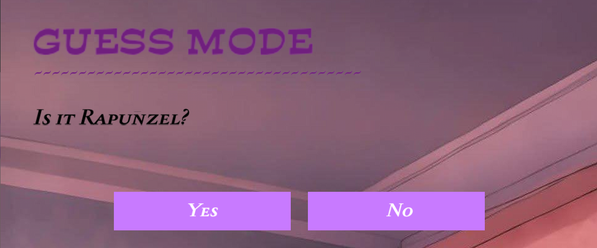
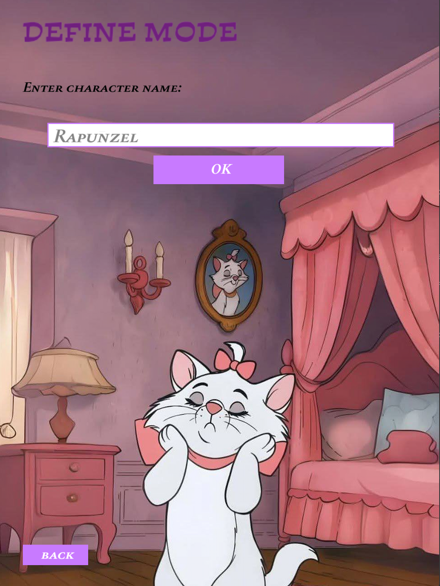
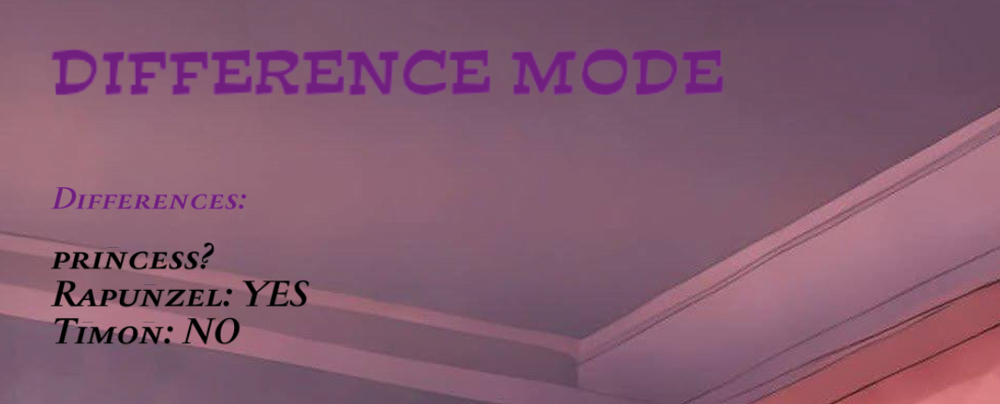

# Акинатор Disney

[_Акинатор_](https://ru.akinator.com/) - популярная игрa, в которой Джинн из лампы пытается угадать загаданного вами персонажа с помощью наводящих вопросов. В проекте реализована игра-пародия в двух версиях (консольная и графическая) на акинатора, но по вселенной мультфильмов **Disney**. Главная фича - возможность расширять базу игры, добавляя своего персонажа, в случае, если Джинн не угадал.

## Геймплей и интерфейс

### Режим GUESS

Это основной режим игры, в котором вы загадываете персонажа и отвчаете на вопросы либо _Yes_ либо _No_, нажимая на соответствующие кнопки, которые подсвечиваются при наведении. В конце игра выдвигает свое предположение по персонажу и спрашивает _Is it ...?_. Далее, если нажать _Yes_, игра порадуется, что угадала и предложит сыграть еще, а если нажать _No_ - расстроится и предложит добавить вашего персонажа в базу. Для этого нужно будет ввести имя героя и то, чем он отличается от предполагаемого.



### Режим DEFINE

Это режим определения. Он даст описание персонажа, имя которого вы впишете в специальное _поле ввода_, поддерживающее клавиши `BackSpace` и `Enter`. Важно, что персонаж должен быть в базе игры. В конце игра предложит определить еще какого-нибудь персонажа.



### Режим DIFFERENCE

Это режим сравнения, в котором можно узнать сходства и разлиичия двух персонажей. Для этого нужно ввести в _поле ввода_ поочередно имя первого и второго персонажей. Снова важно, чтобы персонажи были в базе игры. Если какой-то персонаж не найден, можно ввести еще раз. По сути этот режим опирается на **режим DEFINE**.



В любой моменты игры можно нажать кнопку _back_ в левом нижнем иглу, либо клавишу `Escape`, чтобы вернуться в главное меню игры, а также во время игры на фоне звучит музыка из оригинальной игры Акинатор, в качестве отсылки.

## Установка и запуск
### Консольная версия

> [!NOTE]
> Чтобы запустить консольную версию нужна операционная система Linux

Установить компилятор и [Graphviz](https://graphviz.readthedocs.io/en/stable/manual.html):
```
sudo apt update
sudo apt install build-essential graphviz
```

Скомпилировать программу
```
./AKINATOR_GAME/CONSOLE/console_game.sh
```

Запустить программу
```
./game_mimimi.exe
```

### Графическая версия

> [!NOTE]
> Чтобы запустить графическую версию нуженa операционная система Windows

Установить raylib и [Graphviz](https://graphviz.readthedocs.io/en/stable/manual.html):
```
git clone https://github.com; cd ./vcpkg/; ./bootstrap-vcpkg.bat; ./vcpkg.exe integrate install; ./vcpkg.exe install raylib:x64-windows
sudo apt install build-essential graphviz
```

Скомпилировать программу
```
./AKINATOR_GAME/GAME_APP/app_game.bat
```

Запустить программу
```
./app_mimimi.exe
```

## База данных игры

База представляет собой префиксно записанное дерево в файле формата `.txt`, в узлах которого лежит вопрос пользователю, а в листьях - все персонажи игры. Для работы с деревьями реализованы функции, не зависящие от типа данных _(тип переменной value это void*)_ и не привязанных к игре. 

**Основные функции:**

| Сигнатура функции | Выполянемые задачи |
| --- | --- |
| `tree_init`| Создание и базовая инициализация указателя пустого дерева |
| `node_create` | Создает узлы и заполняет дерево, внтури вызывает функцию инициализации значением |
| `tree_destroy` | Рекурсивное уничтожение узлов |
| `fill_tree` | Заполнение дерева данными с файла, внутри вызывает функцию чтения с файла и создания узлов |
| `read_node` | Рекурсивное чтение узла с файла |
| `print_tree` | Полная печать дерева в файл в префиксной форме, вызывает рекурсивную функцию печати узлов |
| `print_node` | рекурсивная функция печати узлов в файл |
| `tree_dump` | Графический и текстовый вывод состояния дерева |

## Графический Dump дерева

_Графический Dump_ - текстовый и графический вывод состяния дерева, который нужен для более эффективной отладки программы. В графике в узлах выводятся указатели на левые и правые узлы, указатель самого узла и значение, которое в нем лежит. Пример dumpа для реализованной игры:


